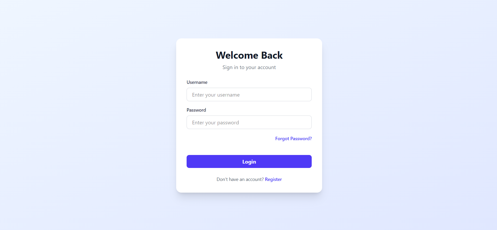
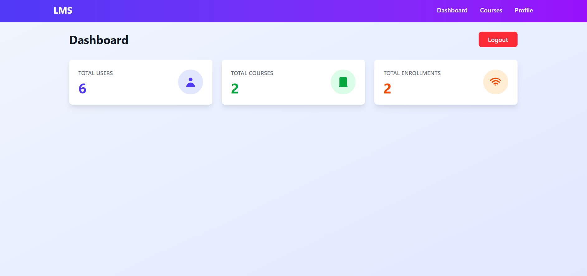
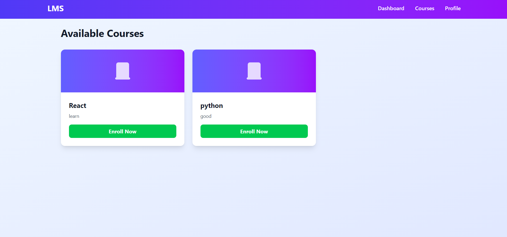

# Full Stack Learning Management System (LMS)

A full-stack Learning Management System built with **Django REST Framework** and **React**. The application includes JWT-based authentication, role-aware workflows, course management, student enrollment, lesson progress tracking, reviews, and quiz-related functionality.

## Live Demo

| Service | URL |
|---|---|
| Frontend | https://lms-rosy-alpha-76b9.vercel.app/ |
| Backend API | https://lms-project-qysk.onrender.com/api/ |
| Django Admin | https://lms-project-qysk.onrender.com/admin/ |

> **Deployment Note:** The backend is hosted on Render's free tier. After a period of inactivity, the first request may take approximately 30–50 seconds while the service starts.

## Screenshots

### Login Page


### Dashboard


### Courses


## Technology Stack

### Backend
- Python
- Django
- Django REST Framework
- SimpleJWT
- PostgreSQL (Neon)
- Gunicorn
- WhiteNoise

### Frontend
- React
- Vite
- Axios
- Tailwind CSS

### Deployment
- Frontend: Vercel
- Backend: Render
- Database: Neon PostgreSQL

## Features

### Authentication & User Management
- User registration and login.
- JWT access and refresh token generation.
- Role information returned during login.
- Authenticated user profile viewing.
- User profile updating.
- Password hashing using Django's built-in password hashing.

### Learning Management
- Course listing and course creation.
- Course categories.
- Lesson management.
- Student course enrollment.
- Lesson completion tracking.
- Individual course progress calculation.
- Course reviews.
- Quiz question creation and quiz submission logic.

### Dashboard
- Total users count.
- Total courses count.
- Total enrollments count.

## User Roles & Permissions

| Role | Responsibilities |
|---|---|
| Admin | Access to the Django administration panel, subject to Django admin permissions. |
| Instructor | Can create courses and add lessons to their own courses. Instructor checks also exist for quiz-related operations. |
| Student | Can enroll in courses, complete lessons, track personal progress, submit quizzes, and review courses they are enrolled in. |

**Note:** Not every endpoint has a separate permission rule for all three roles. Some viewsets currently rely only on authentication.

## Project Structure

```text
Full Stack LMS Project/
│
├── lms_project/                  # Django Backend
│   │
│   ├── accounts/                 # Authentication & User Management
│   │   ├── migrations/
│   │   ├── admin.py
│   │   ├── models.py
│   │   ├── permissions.py
│   │   ├── serializers.py
│   │   ├── urls.py
│   │   └── views.py
│   │
│   ├── lms/                      # LMS Core Application
│   │   ├── migrations/
│   │   ├── admin.py
│   │   ├── models.py
│   │   ├── serializers.py
│   │   ├── tests.py
│   │   ├── urls.py
│   │   └── views.py
│   │
│   ├── lms_project/              # Django Project Configuration
│   │   ├── asgi.py
│   │   ├── settings.py
│   │   ├── urls.py
│   │   └── wsgi.py
│   │
│   ├── build.sh
│   ├── data.json
│   ├── manage.py
│   └── requirements.txt
│
├── lms-frontend/                 # React Frontend
│   │
│   ├── public/
│   │
│   ├── src/
│   │   ├── components/
│   │   │   ├── Navbar.jsx
│   │   │   └── ProtectedRoute.jsx
│   │   │
│   │   ├── pages/
│   │   │   ├── Api/
│   │   │   ├── Courses/
│   │   │   ├── Dashboard/
│   │   │   ├── Login/
│   │   │   ├── Profile/
│   │   │   └── Register/
│   │   │
│   │   ├── App.css
│   │   ├── App.jsx
│   │   ├── index.css
│   │   └── main.jsx
│   │
│   ├── index.html
│   ├── package.json
│   ├── package-lock.json
│   ├── vercel.json
│   └── vite.config.js
│
├── screenshots/
│   ├── Login.png
│   ├── Dashboard.png
│   └── Courses.png
│
└── README.md
```

## API Endpoints

Base URL:

```text
https://lms-project-qysk.onrender.com/api/
```

### Authentication & Account APIs

| Method | Endpoint | Description |
|---|---|---|
| POST | `/accounts/register/` | Register a new user |
| POST | `/accounts/login/` | User login and JWT generation |
| POST | `/accounts/logout/` | User logout endpoint |
| GET | `/accounts/profile/` | Retrieve user profile |
| PUT | `/accounts/profile/update/` | Update user profile |
| POST | `/accounts/forgot-password/` | Password recovery (demo implementation) |
| POST | `/accounts/reset-password/` | Password reset (current implementation) |

### LMS APIs

| Method | Endpoint | Description |
|---|---|---|
| GET, POST | `/courses/` | List and create courses |
| GET, POST, PUT, PATCH, DELETE | `/categories/` | Category operations |
| GET, POST, PUT, PATCH, DELETE | `/lessons/` | Lesson operations |
| GET, POST, PUT, PATCH, DELETE | `/reviews/` | Review operations |
| GET | `/lesson-progress/` | Retrieve personal lesson progress |
| GET | `/dashboard/` | Retrieve dashboard statistics |
| POST | `/enroll/` | Enroll in a course |
| POST | `/lessons/complete/` | Mark a lesson as completed |
| GET | `/courses/<course_id>/progress/` | Retrieve course progress |
| POST | `/questions/add/` | Add quiz questions |
| POST | `/quiz/submit/` | Submit quiz answers |

**API Notes:**
- Authentication is required for the protected endpoints.
- Course creation is restricted to instructors.
- Lesson creation is restricted to instructors creating lessons for their own courses.
- Review creation is restricted to students enrolled in the course.
- Lesson progress is limited to the authenticated user's own progress.
- The quiz and quiz-attempt viewsets exist in the backend code but are not registered in the supplied router. Therefore, their list/create routes are not included above.
- The account endpoints assume the main URL configuration includes account routes under `/api/accounts/`.

## Getting Started

### Prerequisites

- Python
- Node.js and npm
- Git
- PostgreSQL (optional for local development if using the SQLite fallback)

### 1. Clone the Repository

```bash
git clone https://github.com/karib19/LMS_project.git
cd LMS_project
```

### 2. Backend Setup

Navigate to the backend directory:

```bash
cd lms_project
```

Create a virtual environment:

```bash
python -m venv venv
```

Activate the virtual environment on Windows:

```bash
venv\Scripts\activate
```

Install dependencies:

```bash
pip install -r requirements.txt
```

Create a `.env` file inside the backend directory:

```env
SECRET_KEY=your-secret-key
DEBUG=True
DATABASE_URL=your-postgresql-database-url
```

Run database migrations:

```bash
python manage.py migrate
```

Start the Django development server:

```bash
python manage.py runserver
```

Backend URL:

```text
http://127.0.0.1:8000/
```

### 3. Frontend Setup

Open another terminal and navigate to the frontend directory:

```bash
cd lms-frontend
```

Install dependencies:

```bash
npm install
```

Create a `.env` file inside `lms-frontend/`:

```env
VITE_API_URL=http://127.0.0.1:8000/api
```

Start the Vite development server:

```bash
npm run dev
```

Open the local URL displayed in your terminal.

## Environment Variables

### Backend

| Variable | Description |
|---|---|
| `SECRET_KEY` | Django secret key |
| `DEBUG` | Debug mode; use `False` in production |
| `DATABASE_URL` | PostgreSQL database connection URL |

The project supports SQLite as a local fallback when `DATABASE_URL` is not configured, according to the current settings.

### Frontend

Local development:

```env
VITE_API_URL=http://127.0.0.1:8000/api
```

Production:

```env
VITE_API_URL=https://lms-project-qysk.onrender.com/api
```

Do not store private credentials or server secrets in frontend environment variables.

## Deployment

### Backend Deployment — Render

- Build Command: `./build.sh`
- Start Command: `gunicorn lms_project.wsgi`
- Database: Neon PostgreSQL
- Configure `DATABASE_URL`, `SECRET_KEY`, and `DEBUG=False`.
- Configure `ALLOWED_HOSTS` and `CORS_ALLOWED_ORIGINS` for the deployed domains.

### Frontend Deployment — Vercel

- Root Directory: `lms-frontend`
- Framework: Vite
- Environment Variable: `VITE_API_URL`
- Production API URL: `https://lms-project-qysk.onrender.com/api`

## Known Limitations & Security Notes

The following areas need further improvement before the application can be considered production-ready:

1. **Password Recovery:** The current forgot-password endpoint returns a demo response. It does not send a real email containing a secure, expiring reset token.
2. **Password Reset Verification:** The current reset endpoint accepts a user ID and new password without verifying a password-reset token.
3. **Logout:** The supplied logout implementation does not blacklist or revoke the refresh token.
4. **Object-Level Permissions:** Course, lesson, and review update/delete operations need stronger ownership and authorization checks.
5. **Quiz API Routes:** Quiz and quiz-attempt viewsets need to be registered in the router before their endpoints can be accessed through the API.
6. **Role Permissions:** Admin-specific application permissions need a clearly defined and consistently enforced permission policy.
7. **Token Storage:** Frontend token storage and refresh handling should be reviewed to ensure an appropriate security strategy.

## Future Improvements

- Certificate Generation
- Payment Integration
- Course Video Player

## Author

**Sharfuddin Karib**

- GitHub: https://github.com/karib19
- Project Repository: https://github.com/karib19/LMS_project
- Portfolio: https://karib19.github.io/portfolio/

## License

No license has been specified for this project. All rights are reserved by default unless a license is added to the repository.
